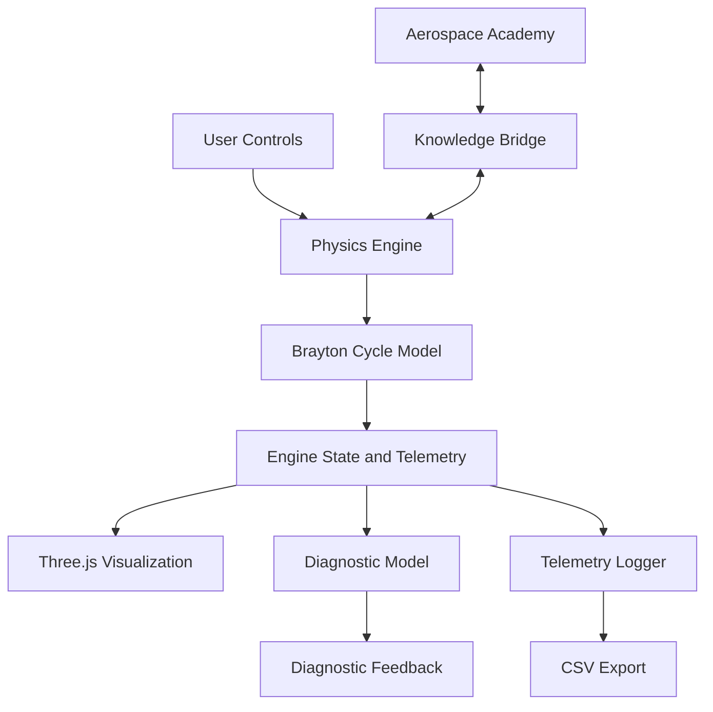

# PropulseAI — Interactive 3D Jet Engine Simulator

**An interactive aerospace engineering platform for exploring jet engine design, thermodynamics, and propulsion through 3D simulation.**

[](https://developer.mozilla.org/en-US/docs/Web/JavaScript)
[](https://threejs.org/)
[](https://vite.dev/)
[](https://developer.mozilla.org/en-US/docs/Web/API/WebGL_API)
[](https://capacitorjs.com/)

---

## Overview

PropulseAI is an interactive 3D jet engine simulator that brings together procedural engine modeling, thermodynamic calculations, real-time visualization, and aerospace education.

The project uses Three.js to generate engine geometry programmatically and a zero-dimensional Brayton-cycle model to simulate engine operating conditions. Users can change flight parameters, observe engine telemetry, inspect internal components, and explore how different operating conditions affect simulated engine behavior.

The application also includes an aerospace learning environment, a rule-based diagnostic system, telemetry logging, and additional interaction features such as camera passthrough and voice commands.

The goal is to make the underlying concepts of jet propulsion easier to explore by connecting engineering theory with visual and interactive experimentation.

## Project Demo

A short demonstration of PropulseAI is available on LinkedIn.

**Watch the project in action:** [View the PropulseAI demonstration on LinkedIn](https://lnkd.in/p/g9mYBQgf)

**Mobile Application:** [Watch the PropulseAI Mobile Application Demonstration](https://drive.google.com/file/d/14nuLywzDQw61PNAQpz_4hzmwgPXzpsu1/view?usp=drive_link)

## Screenshots

### Main Simulation


*The main simulation interface and procedural 3D engine visualization.*

### Engine Inspection

The inspection tools let users explore the engine assembly, examine internal components, and switch between different inspection views.

<p align="center">
   
  
  
</p>

*Exploded assembly and component-level views of the engine.*

### Flight Console and Telemetry


*Adjust operating conditions and observe simulated engine parameters.*

## Features

### 1. Procedural 3D Engine Modeling

Engine components are generated programmatically using Three.js rather than relying entirely on prebuilt 3D assets.

- Procedural construction of engine assemblies and components.
- Turbojet, turbofan, ramjet, and rocket engine configurations.
- Detailed intake, compressor, combustor, turbine, and nozzle geometry.
- Animated engine components and airflow particles.
- Custom GLSL shaders for combustion and heat visualization.
- Studio lighting, metallic materials, and bloom post-processing.

### 2. Interactive Engine Inspection

The simulation includes tools for exploring engine structure beyond its external appearance.

- Exploded views of the complete engine and selected subassemblies.
- Dynamic section cuts to reveal internal components.
- Component isolation and visual highlighting.
- Multiple material modes, including standard, wireframe, glass/X-ray, clay, metallic, UV blueprint, and heat map.
- Air-particle tracing through selected intake and compressor stages.

### 3. Thermodynamic Simulation

The physics engine implements a zero-dimensional Brayton-cycle model for gas-turbine simulation.

Users can change operating conditions and observe the resulting simulated engine state.

- Throttle and ignition controls.
- Altitude and Mach number inputs.
- Engine spool dynamics and transient response.
- Atmospheric pressure, temperature, and density calculations.
- Compressor pressure ratio and combustor temperature calculations.
- Turbine and exhaust calculations.
- Simulated thrust, air mass flow, fuel flow, and thrust-specific fuel consumption (TSFC).

The model is intended for interactive learning and experimentation rather than high-fidelity computational fluid dynamics or certified engineering analysis.

### 4. Flight Controls and Live Telemetry

The flight console provides a central interface for operating the simulator and monitoring its output.

- Idle, Takeoff, and Cruise presets.
- Interactive throttle and flight-condition controls.
- Live engine performance and thermodynamic telemetry.
- RPM, thrust, pressure, temperature, mass-flow, and exhaust-velocity measurements.
- Responsive control layouts for desktop and mobile screens.

### 5. Engine Diagnostics

The diagnostic subsystem evaluates simulated engine telemetry and identifies operating conditions associated with potential anomalies.

- Overtemperature detection.
- Low compressor stall-margin checks.
- Simulated mechanical vibration monitoring.
- Spool overspeed detection.
- Ignition failure and flameout checks.
- Risk classification and diagnostic reason messages.
- Explanatory feedback connecting detected conditions with relevant engineering concepts.

The current diagnostic implementation uses configured rules and risk calculations. It should not be confused with a separately trained predictive-maintenance model.

### 6. Telemetry Logging and Data Export

The simulator records operating data that can be used for further analysis.

- Periodic telemetry collection.
- Recorded engine-state and operating parameters.
- CSV export for external analysis.
- Support for exploratory data analysis and future machine-learning experiments using tools such as Python and Pandas.

Exported telemetry provides a starting point for downstream data-science workflows; it does not imply that a trained external machine-learning model is already integrated.

### 7. Aerospace Academy

The integrated learning environment connects fundamental physics with propulsion concepts.

- Lessons covering motion, velocity, acceleration, force, momentum, and fluid flow.
- Introduction to thermodynamics and the Brayton cycle.
- Interactive SVG illustrations and GSAP animations.
- Formative quizzes with explanatory feedback.
- Learning progression, experience points, and profile tracking.
- Connections between academy lessons and simulation experiments.
- Contextual educational feedback based on selected simulated engine conditions.

### 8. Camera and Voice Interaction

Additional interface capabilities extend the simulation beyond conventional mouse and keyboard controls.

- Camera-passthrough AR overlay using browser camera access.
- Browser-based speech recognition for supported voice commands.
- Responsive desktop and mobile control interfaces.

The camera feature overlays the 3D scene on a live camera feed; it is not a complete spatially tracked WebXR implementation.

### 9. Cross-Platform Development

The repository contains two mobile application pathways.

- **Capacitor:** Packages the primary web application for Android.
- **Expo / React Native:** Provides a separate native mobile implementation using Expo GL and Expo Three.

The two implementations have different architectures, so feature parity between them should not be assumed.

## Technology Stack

| Technology | Purpose |
|---|---|
| JavaScript (ES Modules) | Application logic and simulation orchestration |
| Three.js | Procedural geometry and 3D rendering |
| WebGL | Browser-based graphics rendering |
| GLSL | Custom combustion and heat-visualization shaders |
| HTML5 and CSS3 | Interface and responsive layouts |
| GSAP | Educational animations |
| Vite | Development server and production builds |
| Capacitor | Hybrid Android packaging |
| Expo and React Native | Separate mobile application |
| Expo GL and Expo Three | 3D rendering infrastructure in the mobile application |
| Browser Web APIs | Camera access and speech recognition |

## Architecture

PropulseAI separates the main responsibilities of the application into cooperating subsystems.



The primary components include:

- `SceneManager.js` — Coordinates scene initialization, rendering, and simulation subsystems.
- `PhysicsEngine.js` — Calculates engine operating conditions using the thermodynamic model.
- `EngineFactory.js` — Generates supported engine configurations.
- `ViewManager.js` — Manages exploded views, clipping, component isolation, and material modes.
- `ControlPanel.js` — Handles flight controls, telemetry, and additional interaction features.
- `DiagnosticModel.js` — Evaluates telemetry and generates anomaly classifications.
- `DataLogger.js` — Records telemetry and supports CSV export.
- `LearningEngine.js` — Connects selected diagnostic conditions with educational feedback.
- `KnowledgeBridge.js` — Connects academy activities with the simulation.
- `DatabaseManager.js` — Manages documented authentication and learning-progress workflows.

## Getting Started

### Prerequisites

- Node.js and npm.
- Git.
- A modern browser with WebGL support.

### Installation

Clone the repository and install its dependencies:

```bash
git clone https://github.com/ganeshh0205/engine-simulator.git
cd engine-simulator
npm install
```

Start the development server:

```bash
npm run dev
```

Open the local URL printed in the terminal.

### Production Build

```bash
npm run build
```

The generated production assets are written to the `dist/` directory.


## Project Structure

```text
engine-simulator/
├── android/        # Capacitor Android project
├── mobile/         # Expo / React Native application
├── src/
│   ├── core/       # Simulation, rendering, diagnostics, logging
│   ├── engines/    # Engine configuration factory
│   ├── components/ # Engine component geometry
│   ├── geometry/   # Procedural geometry utilities
│   ├── effects/    # Shaders, particles, and visual effects
│   ├── ui/         # Screens, controls, and interactive lab
│   └── data/       # Academy curriculum
├── docs/           # Technical documentation
├── screenshots/    # README screenshots
├── index.html
├── package.json
└── README.md
```

This is a simplified overview of the repository structure.

## Technical Documentation

For a deeper look at the implementation, refer to the following documents:

| Document | Description |
|---|---|
| [System Architecture](docs/01_SYSTEM_ARCHITECTURE.md) | Application lifecycle and architecture |
| [Graphics and Rendering](docs/02_GRAPHICS_AND_RENDERING.md) | Three.js, shaders, lighting, and visual effects |
| [Engine Geometry and Components](docs/03_ENGINE_GEOMETRY_AND_COMPONENTS.md) | Procedural modeling and engine assemblies |
| [Physics and Thermodynamics](docs/04_PHYSICS_AND_THERMODYNAMICS.md) | Brayton-cycle calculations and engine-state modeling |
| [Interactive Lab and Inspection](docs/05_LAB_SCENE_AND_INSPECTION_MODES.md) | Exploded views, clipping, and material modes |
| [Academy and AI Mentor](docs/06_ACADEMY_AND_AI_MENTOR.md) | Curriculum, assessments, and learning feedback |
| [Control Panel and Interfaces](docs/07_CONTROL_PANEL_AND_INTERFACES.md) | Telemetry, camera passthrough, and voice controls |
| [Diagnostics and Data Logging](docs/08_AI_DIAGNOSTICS_AND_LOGGING.md) | Anomaly evaluation and CSV export |
| [Mobile Architecture](docs/09_CROSS_PLATFORM_MOBILE.md) | Capacitor and Expo deployment paths |
| [Codebase Audit and Verification](docs/10_CODEBASE_HEALTH_AND_STUBS.md) | Verification scripts and codebase notes |
| [Future Roadmap](docs/11_POSSIBILITIES_AND_ROADMAP.md) | Proposed technical enhancements |

## Future Scope

Potential extensions include:

- One-dimensional turbomachinery aerodynamics and stage velocity triangles.
- Dual-spool turbofan modeling and thrust reversers.
- Procedural engine sound synthesis.
- Full WebXR support for immersive AR/VR.
- Machine-learning surrogate physics using ONNX and WebGPU.
- Multiplayer learning environments and controlled fault-injection scenarios.

These are proposed enhancements rather than claims of completed functionality.

## Limitations

PropulseAI is an educational and experimental simulation platform. Its simplified thermodynamic model, procedural geometry, and rule-based diagnostics are not intended for real aircraft operation, safety-critical maintenance decisions, or certified engineering design.

## Author

**Maheedhar Ganesh Chillakanti**

[GitHub Profile](https://github.com/ganeshh0205)

---

PropulseAI brings together interactive 3D visualization, propulsion physics, engine diagnostics, and aerospace learning in one simulation environment.
